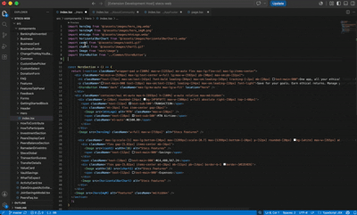

# UI Previewer

Instantly preview any React component in a side panel. No dev server, no Storybook, no manual setup.

## How to use

1. Open any `.tsx` or `.jsx` file in a React project.
2. Click **▶ Preview** at the top of the file.
3. The component renders in a side panel and updates every time you save.

## Features

- **Auto-filled props.** Required props get realistic dummy data based on their TypeScript types.
- **Your real styles.** Tailwind (v3 and v4), CSS, CSS Modules, Sass, Less and Stylus are compiled with your project's own setup.
- **Works with common frameworks.** `next/image`, `next/link` and `next/navigation` work out of the box, and so do Mantine, React Router and React Query. Redux needs no store.
- **Missing data won't break the preview.** Data that comes from APIs, stores or missing providers is replaced with placeholders, so you see the layout instead of an error.
- **Light, dark and checkerboard backgrounds.**

## Settings

| Setting | Description |
| --- | --- |
| `componentPreviewer.codeLensPosition` | `top` (default) shows the Preview link on the first line of the file, `component` shows it above each component. |
| `componentPreviewer.globalCss` | Path to a global stylesheet to load in every preview. Detected automatically in most projects. |
| `componentPreviewer.fillOptionalProps` | Also fill optional props with dummy data. |

## Customizing a preview

Create these optional files in your project's `.vscode` folder:

- `component-preview.props.json` sets your own props, for example `{ "Button": { "label": "Buy now" } }`.
- `component-preview.setup.tsx` default-exports a wrapper component, for adding your own providers such as theme or auth.

## Requirements

The project you preview needs its dependencies installed (`react`, `react-dom`, and Sass, Less or Stylus if you use them).

---
Made by Fuja
